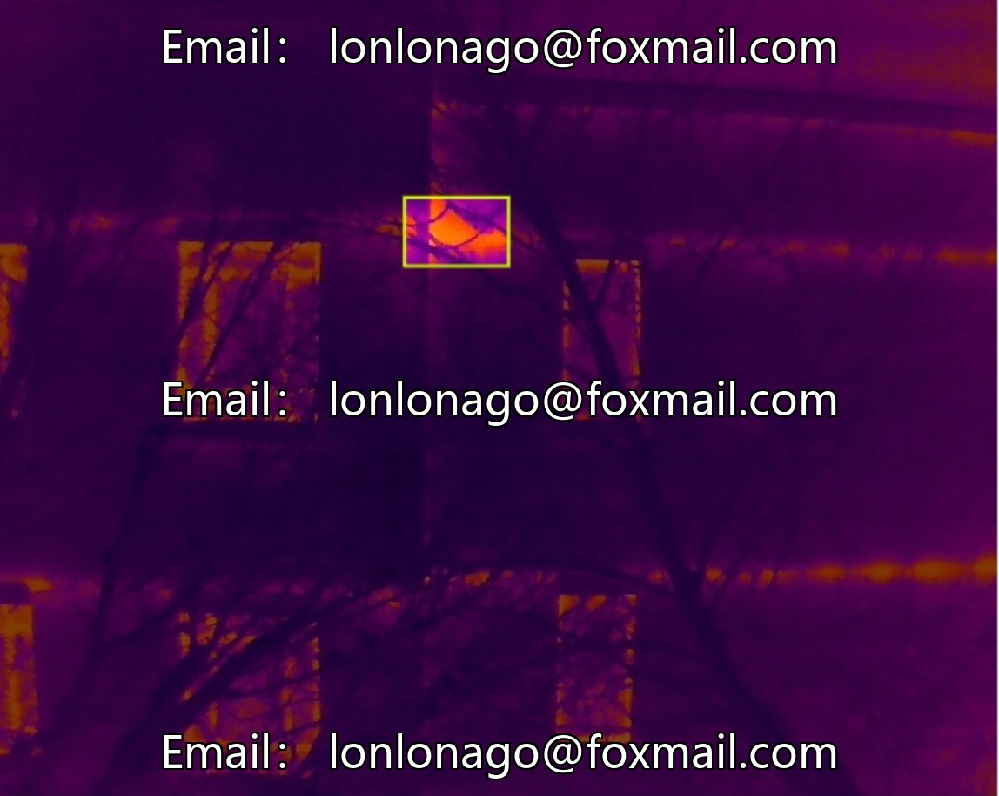
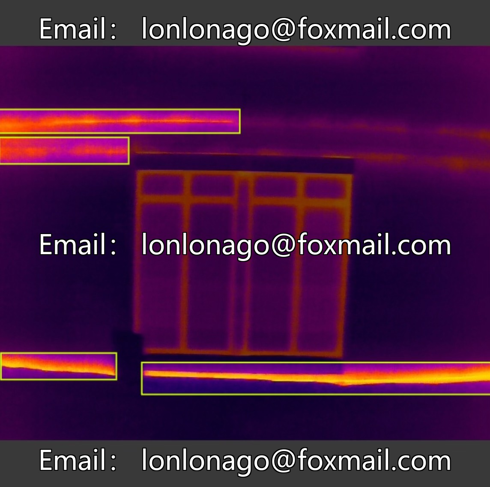
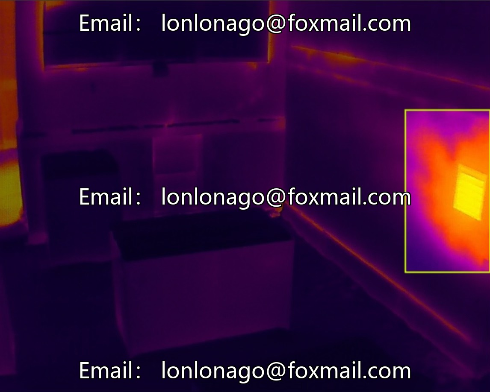
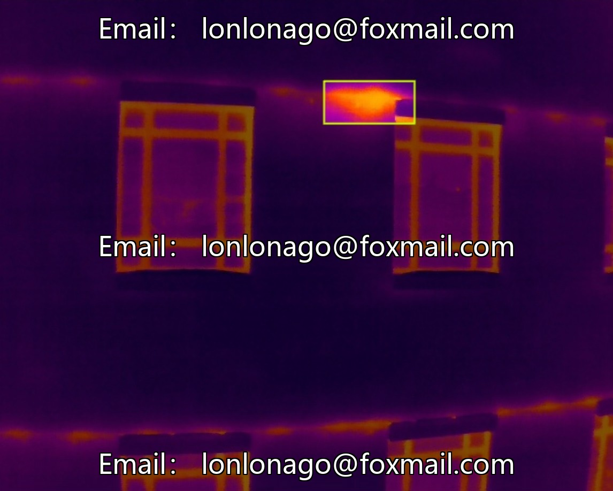
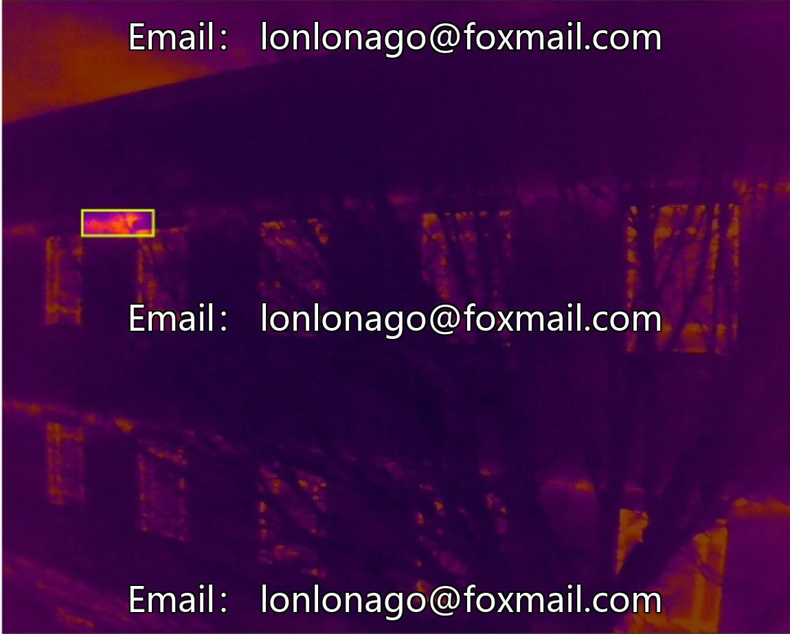

# Intelligent construction site building facade infrared defect recognition dataset, including 656 building facade red

## Body

Intelligent Construction Site Building Facade Infrared Defect Detection Dataset, comprising 656 building facade infrared images, focuses on target detection tasks, suitable for architectural exterior analysis, thermal imaging technology applications, computer vision algorithm optimization and performance verification.

The data format is a regular image file, supports mainstream model input, the quantity is moderate, easy to model training and verification. The core of the dataset is architectural facade infrared images, focusing on target detection tasks. The data category is singular, reducing noise and enhancing model accuracy.

Virtual materials, once sold, are non-refundable.
Interested friends, click "I want" to proceed.

## Images

## Payment

Here is a pay link on Stripe ( https://buy.stripe.com/3cs8yP7sY87d0vu9AB ). Please contact me lonlonago@foxmail.com after funding $89, and I will send you a complete data files , thank you!

